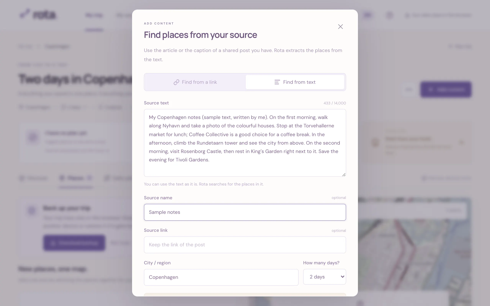
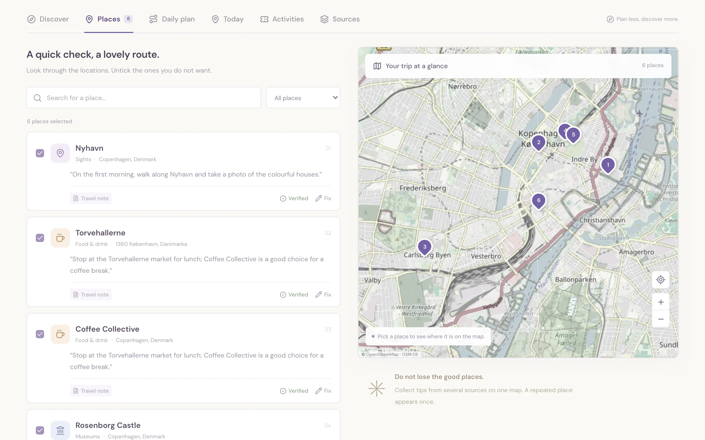

# Rota

Rota turns place recommendations found in travel articles and pasted post captions into a map list that the traveller confirms, and into an editable plan for 1 to 7 days. English and Turkish interface.

> **Status: in development.** It is a working product that has not been publicly launched. The source code is private. The problem is a hypothesis and has not been validated with users, and no users, reviews or adoption are claimed. This repository documents the product thinking.
>
> Part of [Ahsen Varlı İçgüdel's portfolio](https://ahsenvarlicgudel.vercel.app) · [LinkedIn](https://www.linkedin.com/in/ahsen-varl%C4%B1-i%C3%A7g%C3%BCdel-2b785018)

## Key product decisions

1. **Rules-based extraction before any language model.** Rota uses no AI model today. Extraction is rules-based, so there is no API key, no paid model and no account. A language model is considered only if measurement shows a gap it would close.
2. **The user confirms every location.** A place counts as verified only after the traveller confirms it. Ambiguous branches show options, and the product never invents an address or coordinates.
3. **Defer accounts and sync.** One active trip lives in the browser with a JSON backup. Accounts and cross-device sync wait for a later phase that needs a server, a privacy notice and legal review.

Details and limits are below.

## Problem and target user

Recommendations pile up in blog posts, saved posts and notes. Before a trip the traveller has to pull place names out of long text, find the right branch on a map, remember why a place was saved and split the places into days.

**Hypotheses (all untested):** people who save travel posts often can't find them again; day plans are built by hand from scattered sources; poor internet access abroad makes a plan harder to use during a trip.

**Assumed user:** a traveller who collects recommendations weeks before a short city trip of 1 to 7 days, wants to edit their own selection instead of receiving a generated route, and would rather not create an account.

**Discovery:** short past-behaviour interviews are planned (asking how people saved and used recommendations, not showing the product). None have been recorded yet.

## What works today

- **Import:** from an open article URL, or from pasted text or a social-post caption. Video and Reels links are not read, because the user pastes the caption instead.
- **Confirmation step:** places are matched to map locations and the user reviews every one. Ambiguous branches show options, and unmatched places are shown, not hidden.
- **Discover mode** for travellers with no plan yet: place suggestions from Wikivoyage guides with attribution (CC BY-SA 4.0).
- **Editable day plan** for 1 to 7 days, a map, Google Maps day links, KML for Google My Maps and a JSON backup.

| | |
|---|---|
|  |  |
| Paste text or a caption. | Confirmed places on a map. |
|  |  |
| Editable day plan. | The "Today" view. |

All screenshots use an invented sample text about Copenhagen.

## Selected product decisions and trade-offs

- **Reading, extracting and matching are separate stages**, and success and gaps are reported for each. A single "places found" number hides where a pipeline fails.
- **A location is verified only after the user confirms it.** The product never invents an address or coordinates.
- **Rules-based extraction first**, with no API key, paid model or account. A language model or a new map provider is considered only if measurement shows a gap it would close.
- **No scraping of protected pages** and no video understanding. The user pastes the caption.
- **One active trip in the browser**, with a JSON backup to move it. Accounts and sync are deferred until there is a server, a privacy notice and legal review.
- **Honest planning:** stops are grouped by straight-line proximity and the map says so. There are no road-routing, opening-hours or live-transit claims.
- **Restrained use of the public geocoder:** one request per second, a 24-hour cache, back-off after refusals and a 30-second search budget.
- **Measure before building:** the first sprint measures the existing pipeline on real articles, and stronger extraction is considered only against the gaps found.
- **A written list of claims the product will not make:** no video understanding, no automatic Instagram or Google Maps list import, no "AI" or "smart assistant" wording, no "best route", no accuracy percentage, no "works in every city", no sync, no invented users or reviews.

## Architecture overview

1. **Import:** a server route reads an open article page after URL safety checks, or accepts pasted text. A rules-based extractor finds candidate places (proper names, travel cues and a small example gazetteer for two cities), capped per import. Every place keeps its source sentence.
2. **Location matching:** a public OpenStreetMap-based geocoder restricted to the destination city, then a check that the type of the found place fits what the name implies. The user confirms every place.
3. **Discovery:** Wikivoyage guides through its public API, with a stored copy for two example cities.
4. **State and output:** the trip lives in the browser. The user edits the plan and exports it.

**Data flow, stated plainly:** pasted text and links go to the app's server for import, place names go to the public geocoder, and map tiles come from OpenStreetMap. Only the saved trip stays in the browser, so "nothing leaves your device" would be wrong.

## Technology (verified from source)

TypeScript, Next.js (vinext), React 19, Leaflet, Mozilla Readability, Zod and drizzle-orm. Tests use `node:test` with fixtures, and CI runs the tests, the type check and the build.

## How it is built

The owner decides scope, cost and release. Claude Code agents do the planning, implementation and independent QA review through GitHub issues, task branches and draft pull requests. Details: [agent-based development](https://github.com/ahsenvi/product-decision-assistant-showcase/blob/main/docs/agent-based-development.md).

## Limits and next steps

- Extraction can miss names or suggest non-places, so review is required.
- A slow map service can leave an import partial.
- One trip per browser, with no sync.
- **Not built:** photo upload, memory journal, account connection, publishing to social media, multiple trips. They are on the roadmap and not shown as working.

The next phase is an open owner decision.
